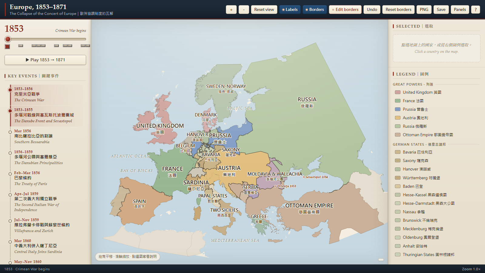
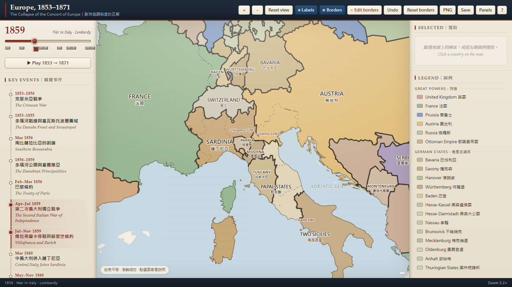
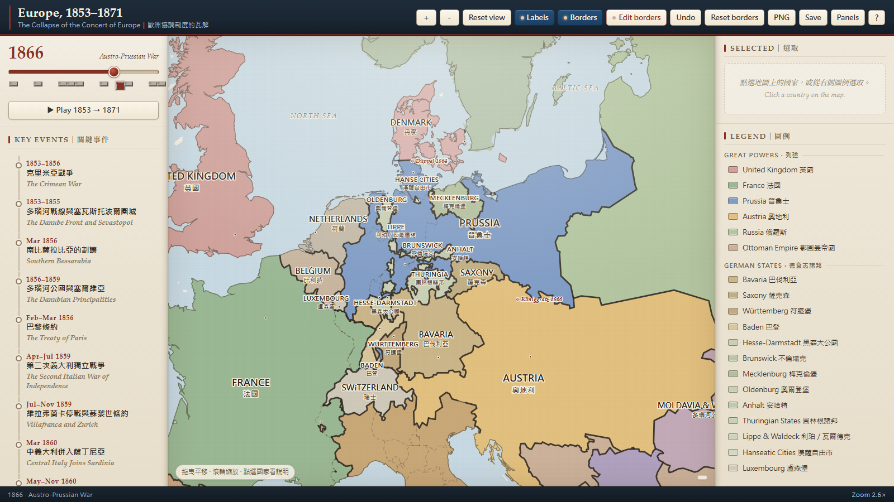
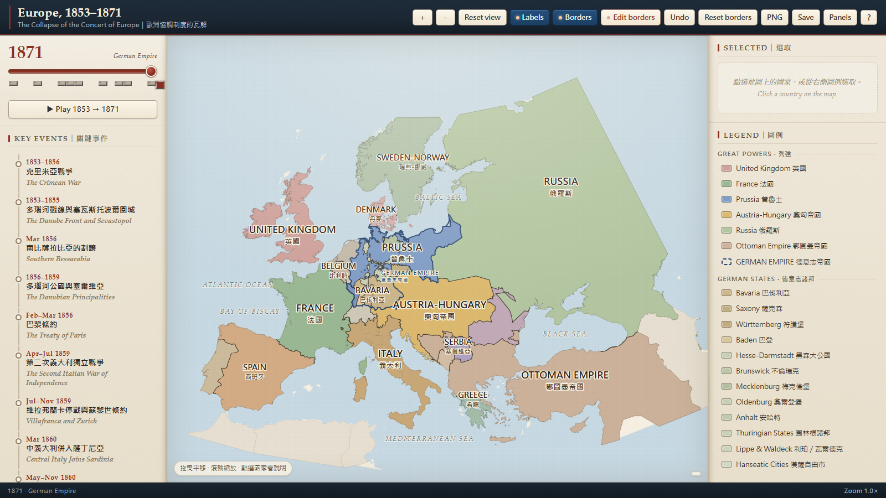

# Europe, 1853–1871｜歐洲協調制度的瓦解

**一張可以拖拉調整國界、可切換年代的互動歷史地圖**，涵蓋近代外交史的關鍵斷裂期：從克里米亞戰爭到德意志統一（1853–1871）。

> 線上版：`https://<你的帳號>.github.io/europe-1853-1871/`
> 單一 HTML 檔、完全離線可用、不需安裝任何軟體。



---

## 這是什麼

以 1815 與 1878 兩份數位化歷史地圖為骨架、再用現代行政區界校正割讓線所重建的歐洲政治地圖，支援：

- **10 個時代斷點**：1853 / 1856 / 1859 / 1860 / 1861 / 1864 / 1866 / 1867 / 1870 / 1871，滑桿或事件清單皆可切換
- **49 個地塊、45 個政治實體**：英、法、普魯士、奧地利（1867 後奧匈）、俄羅斯、鄂圖曼，以及德意志與義大利諸邦、巴爾幹各國
- **英文原文國名**（1853 年當時用法），中文為副標
- **疆域可自由調整**：`Edit borders` → 點國家 → 拖曳節點（鄰國共用邊界會一起移動）；支援 `Undo`／`Reset borders`
- **27 個關鍵事件**：點選即在右欄顯示起因、經過、條約條款與對「歐洲協調」的意義
- **匯出**：PNG（放進講義／PPT）與 JSON（保存你調整後的疆界）

## 怎麼用

1. 直接開線上版網址（見上方）。
2. 或把本 repo 的 `index.html` 下載後雙擊開啟（完全離線，適合課堂沒網路時）。
3. 詳細操作與五個課堂活動，見 [`使用說明.md`](使用說明.md)（另有 Word 版 `Europe_1853-1871_使用說明.docx`）。

### 鍵盤快捷鍵

| 按鍵 | 功能 | 按鍵 | 功能 |
|---|---|---|---|
| ←　→ | 逐年 | Space | 播放／暫停 |
| PageUp／PageDown | 跳關鍵年代 | E | 疆界編輯 |
| ＋　－ | 縮放 | L | 國名標籤 |
| R | 重設視角 | Esc | 取消選取 |

深連結可直接寫進講義：`index.html#y=1871`、`index.html#y=1866&sel=prussia`、
`index.html#y=1871&k=2.4&clon=8.5&clat=49.5`

## 更多畫面

| 1859 義大利：倫巴底歸薩丁尼亞、曼圖亞仍在奧地利 | 1866 普奧戰爭後的普魯士兼併 |
|---|---|
|  |  |



## 資料來源與授權

本站是**歷史 GIS 資料的衍生作品**，非 AI 生成圖形；邊界重建方法與精度聲明見[使用說明](使用說明.md)第 7 節。

- **歷史疆域骨架**：[historical-basemaps](https://github.com/aourednik/historical-basemaps)（André Ourednik，**CC BY-SA 4.0**）——1815 與 1878 兩張世界歷史地圖
- **海岸線與行政區界**：[Natural Earth](https://www.naturalearthdata.com/) 1:10m（**public domain**）
- **史料文字**：本專案整理，供教學使用，非學術引文
- 原歷史圖層在比薩拉比亞（1815 圖誤歸鄂圖曼、1878 圖誤歸羅馬尼亞）與高加索空白處有誤，已於本專案修正

因衍生自 CC BY-SA 4.0 資料，**本 repo 內容以 [CC BY-SA 4.0](https://creativecommons.org/licenses/by-sa/4.0/deed.zh_TW) 釋出**：可自由使用、改作、教學與商業利用，但須保留上述姓名標示，且改作後同樣以 CC BY-SA 4.0 釋出。

## 檔案

```
index.html                        最終地圖（單檔，含全部 CSS/JS/資料）
使用說明.md / .docx               完整操作說明（Markdown 與 Word）
screenshots/                      說明用截圖
.nojekyll                         告訴 GitHub Pages 不要跑 Jekyll
```

## 更新方式

改版後只要用新的 `index.html` 覆蓋舊檔（GitHub 網頁上：`Add file → Upload files`），
Pages 約 1–2 分鐘後自動更新。若同網址看到舊版，按 `Ctrl + F5` 強制重新整理。

## 致謝

- André Ourednik — historical-basemaps
- Natural Earth — 地理資料
- 介面設計與地圖引擎：本專案自製（SVG + Lambert 等角圓錐投影）
